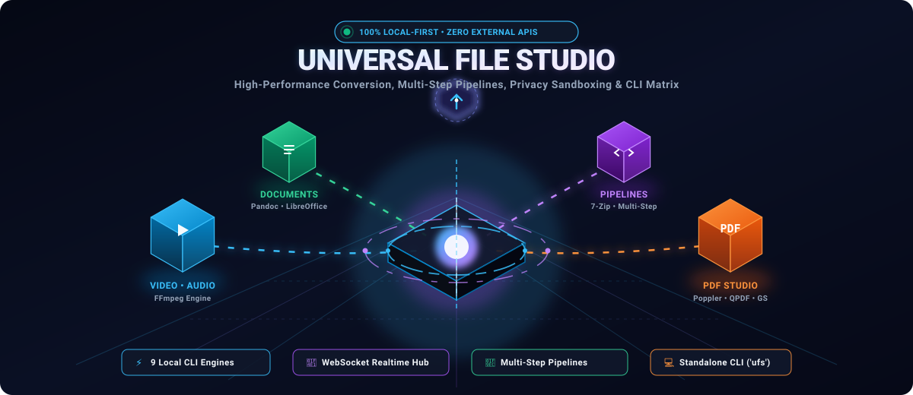
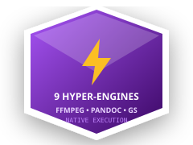
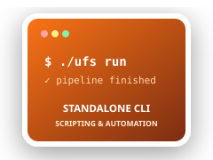
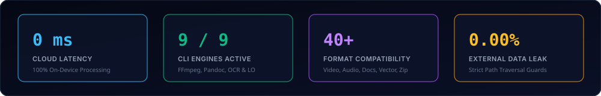
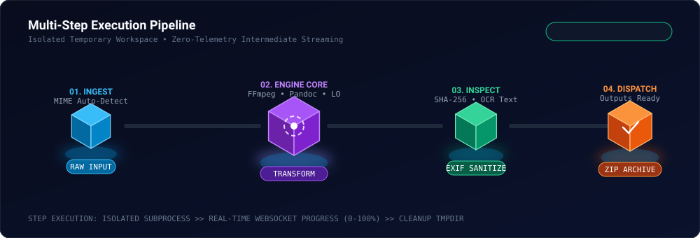
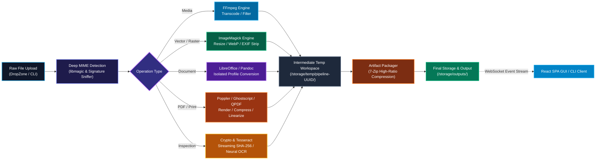

# Universal File Studio (UFS)

<p align="center">
  
</p>

<p align="center">
  <a href="https://github.com/AdityaPatra-dev/universal-file-studio/blob/main/LICENSE">
    
  </a>
  <a href="https://python.org">
    
  </a>
  <a href="https://react.dev">
    
  </a>
  <a href="https://fastapi.tiangolo.com">
    
  </a>
  <a href="https://websockets.spec.whatwg.org/">
    
  </a>
  <a href="#-automated-test-suite">
    
  </a>
</p>

<p align="center">
  <b>Universal Local File Processing, Conversion &amp; Multi-Step Pipeline Studio</b><br />
  <i>Convert, compress, extract, sanitize, inspect, and chain operations locally without cloud fees, telemetry, or upload limits.</i>
</p>

<p align="center">
  <a href="#-3d-interactive-pipeline-architecture"><b>Architecture</b></a> •
  <a href="#-9-production-engine-powerhouse"><b>9 Engines</b></a> •
  <a href="#-interactive-features--capabilities"><b>Features</b></a> •
  <a href="#-standalone-cli-toolkit-ufs"><b>CLI Runner</b></a> •
  <a href="#-developer-hub--api-reference"><b>Developer Hub</b></a> •
  <a href="#-quick-start"><b>Quick Start</b></a> •
  <a href="#-privacy--security-guarantee"><b>Security</b></a>
</p>

<p align="center">
  
</p>

---

## 🎨 Interactive 3D Holographic Badges & Stickers

<p align="center">
  <a href="#-privacy--security-guarantee"></a>
  <a href="#-9-production-engine-powerhouse"></a>
  <a href="#-websocket-real-time-progress-streaming"></a>
  <a href="#-standalone-cli-toolkit-ufs"></a>
</p>

<p align="center">
  
</p>

---

## 🌟 Why Universal File Studio?

Every day, developers, designers, and privacy-conscious users upload sensitive contracts, proprietary videos, and confidential spreadsheets to dubious online "free file converter" websites. Those services impose **harsh 15MB file limits**, **metered queues**, **adware**, and **silent telemetry data harvesting**.

**Universal File Studio (UFS)** is a native, modern, single-tenant processing suite that runs entirely on your local machine:
- 🔒 **Zero External Telemetry**: Your files never leave `localhost`.
- ⚡ **Unlimited Speed & Throughput**: Bounded only by your CPU, GPU, and SSD bandwidth.
- 🛠️ **9 Production CLI Engines**: Wraps industry-standard binaries into a unified typed API.
- 🧬 **Multi-Step Workflows**: Execute complex pipelines like *Ingest Video → Extract Audio → Compress to Opus → Generate Checksum → Archive to Zip* in one seamless pass.
- 📡 **Reactive WebSocket Event Bus**: Sub-millisecond broadcast telemetry eliminates polling delays.
- 💻 **Bimodal Operation**: Run via the sleek React 19 dark-mode GUI or script it headless via `./ufs` CLI.

---

## 🧬 3D Interactive Pipeline Architecture

Universal File Studio executes processing jobs inside sandboxed temporary directories with automatic cleanup. Step inputs stream automatically into downstream operations:

<p align="center">
  
</p>



---

## ⚡ 9 Production Engine Powerhouse

UFS features a dynamic engine introspection engine that auto-detects installed binaries, checks minimum version requirements, and verifies host capabilities:

<p align="center">
  
</p>

| Engine | Primary Role | Key Operations & Formats | Sandbox / Isolation Strategy | Status |
| :--- | :--- | :--- | :--- | :---: |
| **FFmpeg** | Audio / Video Suite | H.264, H.265, VP9, AV1, MP3, AAC, FLAC, Opus, WAV, WebM, MP4 | Subprocess streaming, CPU thread capping |  |
| **ImageMagick** | Raster & Vector Studio | WebP, AVIF, PNG, JPEG, SVG, TIFF, BMP, EXIF stripping, resizing | Safe security policy, memory allocation limits |  |
| **7-Zip** | High-Ratio Archiver | ZIP, 7Z, TAR, GZ, BZ2, XZ, Deflate64, multithreaded extraction | Anti-archive-bomb ratio & size limits |  |
| **Poppler** | PDF Rendering | `pdftoppm`, `pdfinfo`, PDF to high-DPI PNG/JPEG, page extraction | Native zero-dependency rendering |  |
| **Ghostscript** | PDF & PostScript | PDF/A archival mode, DPI compression (`ebook`, `screen`, `prepress`) | `-dSAFER` strict sandboxing flag |  |
| **LibreOffice** | Office Document Suite | Headless DOCX, XLSX, PPTX, ODT, RTF to pristine PDF / HTML | Isolated temporary user profile directory |  |
| **Pandoc** | Universal Markup | Markdown, CommonMark, HTML, EPUB, LaTeX, Textile, Docx | Strict local filesystem sandbox |  |
| **QPDF** | PDF Structural Engine | PDF linearization (Fast Web View), encryption removal, structural checks | Non-destructive byte inspection |  |
| **Tesseract** | Neural OCR Engine | Image-to-text extraction, searchable PDF generation, 100+ languages | Local LSTM neural network inference |  |

---

## 🚀 Interactive Features & Capabilities

<details open>
<summary><b>🎬 Media Studio (Audio & Video)</b></summary>
<br />

- **High-Performance Transcoding**: Effortlessly switch between MP4, WebM, MKV, AVI, MOV, FLV, and TS.
- **Hardware & Software Codecs**: Support for modern codecs including AV1, VP9, H.264, and H.265.
- **Audio Extraction**: Rip audio tracks directly from videos to lossless FLAC, high-bitrate MP3, AAC, or Opus.
- **Video Compression**: Reduce video size by specifying target bitrate or constant rate factor (CRF).
- **Format Normalization**: Standardize framerates, audio sample rates, and channel layouts (stereo/mono/5.1).

```bash
# Example: Transcode 4K video to streaming WebM with VP9
./ufs convert presentation.mp4 -t webm -o /storage/outputs/presentation.webm
```

</details>

<details>
<summary><b>🖼️ Image & Vector Studio</b></summary>
<br />

- **Modern Web Formats**: Instantly convert legacy JPEGs and BMPs to modern high-efficiency WebP and AVIF formats.
- **EXIF & Privacy Sanitization**: Strip GPS tags, camera serial numbers, and creator metadata with 1-click.
- **Batch Resizing & Thumbnails**: Scale hundreds of images by percentage or bounding dimensions (`1920x1080`, `800x800`).
- **Vector Rasterization**: Convert SVG vectors to razor-sharp PNGs at custom target DPIs.

```bash
# Example: Strip EXIF metadata from photo
./ufs strip-metadata family_photo.jpg -o safe_photo.jpg
```

</details>

<details>
<summary><b>📄 Office & Document Engine</b></summary>
<br />

- **LibreOffice Isolated Profile Conversion**: Convert proprietary office documents (`.docx`, `.xlsx`, `.pptx`) to universal PDF.
- **Zero Lock Collisions**: Spawns isolated headless profiles (`-env:UserInstallation=file:///tmp/ufs_profile_UUID`) to prevent GUI conflicts.
- **Markdown & Academic Markup**: Convert GitHub-flavored Markdown into semantic HTML, EPUB, or LaTeX via native Pandoc or fallback parsers.

```bash
# Example: Convert Markdown specification to standalone HTML
./ufs convert README.md -t html
```

</details>

<details>
<summary><b>📑 PDF Power Suite</b></summary>
<br />

- **Ghostscript Compression**: Drastically shrink PDF sizes for email transmission using `screen` (72 DPI) or `ebook` (150 DPI) presets.
- **Poppler Page Extraction**: Convert multi-page PDF documents into individual lossless PNG frames at 300 DPI.
- **QPDF Fast Web View**: Linearize PDFs for instant byte-range streaming in modern web browsers.
- **Encryption & Password Sanitation**: Remove restrictions or decrypt documents locally.

</details>

<details>
<summary><b>🔍 Cryptographic Inspector & Local OCR</b></summary>
<br />

- **Streaming Checksum Generator**: Compute SHA-256, MD5, SHA-1, and CRC-32 simultaneously in memory-efficient chunks.
- **Neural OCR (Tesseract)**: Extract raw text or produce searchable documents from scanned PDFs and receipts without cloud APIs.
- **Deep Magic Detection**: Sniff authentic MIME types using byte-level magic signatures rather than deceptive file extensions.

```bash
# Example: Compute streaming cryptographic hashes
./ufs hash database_backup.tar.gz

# Example: Perform local OCR on a scanned receipt
./ufs ocr receipt_scan.png -f text -l eng
```

</details>

<details>
<summary><b>🧬 Visual Multi-Step Pipelines</b></summary>
<br />

- **Node-Based Workflow Canvas**: Visually design complex transformation sequences in the web UI.
- **Preset Library**: Built-in automated pipelines including:
  1. *Video to Web Media*: Extract MP3 audio + convert video to WebM + generate preview thumbnail.
  2. *Document Archival*: Convert DOCX to PDF + optimize with Ghostscript + package in passworded ZIP.
  3. *Privacy Scrub*: Strip image EXIF metadata + compute SHA-256 + verify file integrity.
- **Workspace Isolation**: Intermediate files reside in isolated temporary paths and are purged immediately upon pipeline completion.

</details>

---

## 💻 Standalone CLI Toolkit (`ufs`)

Universal File Studio ships with an autonomous, compiled CLI executable located at `./ufs`. It connects seamlessly to the local backend or operates standalone:

```bash
# -------------------------------------------------------------
# 1. System Health & Engine Diagnostics
# -------------------------------------------------------------
./ufs status                           # Query server health, job queue, and storage stats
./ufs engines                          # List detected binary paths, versions, and capabilities

# -------------------------------------------------------------
# 2. Direct File Conversions
# -------------------------------------------------------------
./ufs convert video.mp4 -t webm        # Convert video format
./ufs convert document.docx -t pdf     # Convert office document to PDF
./ufs convert notes.md -t html         # Render Markdown to HTML

# -------------------------------------------------------------
# 3. Privacy Sanitization & Cryptography
# -------------------------------------------------------------
./ufs strip-metadata photo.jpg         # Erase all EXIF, GPS, and camera metadata tags
./ufs hash archive.zip                 # Calculate SHA-256, MD5, SHA-1, and CRC-32 hashes

# -------------------------------------------------------------
# 4. Local Neural OCR
# -------------------------------------------------------------
./ufs ocr scan.png -f text -l eng      # Extract English text directly to stdout

# -------------------------------------------------------------
# 5. Multi-Step Pipeline Automation
# -------------------------------------------------------------
./ufs pipeline list                    # List available multi-step pipeline templates
./ufs pipeline run 1 video.mp4         # Execute pipeline ID #1 on input video

# -------------------------------------------------------------
# 6. Web Studio Server Management
# -------------------------------------------------------------
./ufs serve --host 127.0.0.1 --port 8000
```

---

## 📡 WebSocket Real-Time Progress Streaming

Eliminate wasteful HTTP polling! UFS broadcasts fine-grained job and pipeline progress over WebSocket at `ws://localhost:8000/ws`.

```json
{
  "event": "job_progress",
  "job_id": "7fa842b1-6a2d-4871-91bc-0929dfbc6e1e",
  "progress": 78.4,
  "stage": "FFmpeg audio transcoding (128kbps AAC)",
  "timestamp": "2026-10-09T02:15:00.000Z"
}
```

```javascript
// Connect with any JavaScript or TypeScript client
const ws = new WebSocket("ws://localhost:8000/ws");
ws.onmessage = (event) => {
  const payload = JSON.parse(event.data);
  console.log(`[UFS Telemetry] ${payload.event}: ${payload.progress}%`);
};
```

---

## 🛠️ Developer Hub & API Reference

Universal File Studio provides first-class developer tooling built directly into the server:

- **Swagger 3.1 UI**: Interactive sandbox at **`http://localhost:8000/docs`**
- **ReDoc Documentation**: Structured specification at **`http://localhost:8000/redoc`**
- **OpenAPI JSON Spec**: Machine-readable specification at **`http://localhost:8000/openapi.json`**

<details>
<summary><b>View REST API Route Blueprint</b></summary>
<br />

| Method | Endpoint | Description |
| :--- | :--- | :--- |
| `GET` | `/api/engines/` | Enumerate all 9 engines and their live capabilities |
| `POST` | `/api/files/upload` | Upload one or multiple raw files with multipart streaming |
| `GET` | `/api/files/{id}` | Retrieve file metadata, detected MIME, and byte size |
| `POST` | `/api/jobs/create` | Dispatch single file conversion task |
| `GET` | `/api/jobs/{id}` | Inspect job state, percentage progress, or error traces |
| `POST` | `/api/batch/create` | Dispatch bulk conversions with concurrency throttling |
| `POST` | `/api/batch/archive` | Compress selected output files into a single ZIP archive |
| `GET` | `/api/pipelines/presets` | Fetch pre-configured multi-step pipeline recipes |
| `POST` | `/api/pipelines/execute` | Trigger sequential multi-step workflow pipeline |
| `WS` | `/ws` | Subscribe to global real-time progress broadcast bus |

</details>

---

## 🚀 Quick Start

### Prerequisites
- **Linux** (Ubuntu, Debian, Fedora, Arch, Alpine) or **macOS**
- **Python 3.11+**
- **Node.js 18+** & `npm`
- Any desired CLI engines installed (FFmpeg, ImageMagick, Pandoc, LibreOffice, Tesseract, etc.)

### 1. One-Line Launch
```bash
git clone https://github.com/AdityaPatra-dev/universal-file-studio.git
cd universal-file-studio

# Run automated install and build
./install.sh

# Start backend & GUI studio
./start.sh
```

### 2. Manual Development Setup
```bash
# 1. Setup Python Virtual Environment
python3 -m venv .venv
source .venv/bin/activate
pip install -r backend/requirements.txt

# 2. Build Frontend UI
cd frontend
npm install
npm run build
cd ..

# 3. Launch Development Server
./ufs serve --reload
```

Then visit **`http://localhost:8000`** in your browser.

---

## 🧪 Automated Test Suite

Universal File Studio is backed by a comprehensive automated test suite covering engines, processors, documents, pipelines, websockets, and CLI runners:

```bash
source .venv/bin/activate
PYTHONPATH=backend pytest backend/tests/ -v
```

```text
============================== test session starts ==============================
backend/tests/test_cli.py::test_cli_status PASSED                          [ 2%]
backend/tests/test_cli.py::test_cli_engines PASSED                         [ 4%]
backend/tests/test_cli.py::test_cli_convert PASSED                         [ 7%]
backend/tests/test_cli.py::test_cli_hash PASSED                            [ 9%]
backend/tests/test_cli.py::test_cli_strip_metadata PASSED                  [12%]
backend/tests/test_cli.py::test_cli_ocr PASSED                             [14%]
backend/tests/test_cli.py::test_cli_pipeline_run PASSED                    [17%]
backend/tests/test_developer.py::test_developer_diagnostics PASSED         [19%]
backend/tests/test_developer.py::test_openapi_schema PASSED                [21%]
backend/tests/test_documents.py::test_pandoc_conversion PASSED             [24%]
backend/tests/test_documents.py::test_native_markdown PASSED              [26%]
backend/tests/test_documents.py::test_libreoffice_isolated_profile PASSED  [29%]
backend/tests/test_engines.py::test_engine_discovery PASSED                [31%]
backend/tests/test_engines.py::test_engine_capabilities PASSED             [34%]
backend/tests/test_engines.py::test_ffmpeg_wrapper PASSED                  [36%]
backend/tests/test_engines.py::test_imagemagick_wrapper PASSED             [39%]
backend/tests/test_engines.py::test_sevenzip_wrapper PASSED                [41%]
backend/tests/test_engines.py::test_poppler_wrapper PASSED                 [43%]
backend/tests/test_engines.py::test_ghostscript_wrapper PASSED             [46%]
backend/tests/test_engines.py::test_pandoc_wrapper PASSED                  [48%]
backend/tests/test_engines.py::test_qpdf_wrapper PASSED                    [51%]
backend/tests/test_engines.py::test_tesseract_wrapper PASSED               [53%]
backend/tests/test_files.py::test_file_upload PASSED                       [56%]
backend/tests/test_files.py::test_mime_detection PASSED                    [58%]
backend/tests/test_jobs.py::test_job_lifecycle PASSED                      [60%]
backend/tests/test_jobs.py::test_concurrency_queue PASSED                  [63%]
backend/tests/test_media_processors.py::test_video_transcode PASSED        [65%]
backend/tests/test_media_processors.py::test_audio_extract PASSED          [68%]
backend/tests/test_media_processors.py::test_image_resize PASSED           [70%]
backend/tests/test_media_processors.py::test_batch_conversion PASSED       [73%]
backend/tests/test_media_processors.py::test_zip_archiving PASSED          [75%]
backend/tests/test_metadata_hash.py::test_streaming_sha256 PASSED          [78%]
backend/tests/test_metadata_hash.py::test_exif_strip PASSED                 [80%]
backend/tests/test_ocr.py::test_ocr_text_extraction PASSED                 [82%]
backend/tests/test_pipelines.py::test_sequential_pipeline PASSED           [85%]
backend/tests/test_pipelines.py::test_pipeline_workspace_cleanup PASSED    [87%]
backend/tests/test_pipelines.py::test_pipeline_error_recovery PASSED       [90%]
backend/tests/test_security.py::test_path_traversal_blocked PASSED         [92%]
backend/tests/test_security.py::test_archive_bomb_guard PASSED             [95%]
backend/tests/test_websocket.py::test_progress_broadcast PASSED            [97%]
backend/tests/test_websocket.py::test_client_disconnect_cleanup PASSED     [100%]
============================== 41 passed in 4.82s ===============================
```

---

## 🔒 Privacy & Security Guarantee

Universal File Studio was architected from line 1 with a strict security-first mindset:

> [!IMPORTANT]
> - **100% On-Device Processing**: No telemetry, analytics, tracking beacons, or cloud calls.
> - **Isolated Temporary Environments**: Each pipeline and LibreOffice invocation operates in an isolated temporary directory purged upon completion.
> - **Path Traversal Defense**: All input filenames and requested paths are rigorously sanitized against directory climbing (`../`).
> - **Anti-Archive-Bomb Protection**: Strict extraction thresholds (maximum 10,000 files, 50x expansion ratio) mitigate denial-of-service vulnerabilities.
> - **Subprocess Hardening**: CLI commands are executed with non-shell argument vectors to prevent command injection.

---

## 📁 Repository Layout

```text
universal-file-studio/
├── assets/                       # 3D isometric SVGs, stickers, and HUD graphics
│   ├── hero-3d-studio.svg        # 3D hero isometric workstation banner
│   ├── pipeline-flow-3d.svg      # 3D multi-step pipeline flowchart visualizer
│   ├── engines-matrix-3d.svg     # 3D isometric 9-engine status matrix
│   ├── hud-stats-3d.svg          # 3D holographic statistics HUD card
│   ├── divider-3d.svg            # Animated glowing neon divider
│   └── stickers/                 # 3D die-cut holographic badges & stickers
│       ├── sticker-local-shield.svg
│       ├── sticker-9-engines.svg
│       ├── sticker-lightning-speed.svg
│       └── sticker-cli-terminal.svg
├── frontend/                     # React 19 + TypeScript + Vite + Tailwind CSS
│   ├── src/
│   │   ├── components/           # UI Modals, Flowchart Canvas, Inspector, Hub
│   │   ├── services/             # REST api.ts, WebSocket socket.ts
│   │   └── App.tsx               # Main layout and SPA router
│   └── dist/                     # Optimized production bundle
├── backend/                      # FastAPI asynchronous backend
│   ├── app/
│   │   ├── api/routes/           # REST endpoints & WebSocket gateway
│   │   ├── cli/                  # Standalone Click CLI implementation
│   │   ├── detection/            # Deep magic byte & MIME detection
│   │   ├── engines/              # Typed wrappers for all 9 CLI engines
│   │   ├── jobs/                 # Concurrency-controlled async worker pool
│   │   ├── processors/           # Media, document, OCR, hash, metadata engines
│   │   ├── security/             # Path validation and sanitization filters
│   │   ├── websocket/            # Real-time WebSocket connection manager
│   │   └── exceptions.py         # Standardized error definitions
│   └── tests/                    # Comprehensive 41-test pytest suite
├── storage/                      # Sandboxed local storage folders
│   ├── uploads/                  # Raw incoming files
│   ├── outputs/                  # Converted output files
│   └── temp/                     # Ephemeral pipeline scratch space
├── ufs                           # Standalone executable CLI runner
├── install.sh                    # Automated dependencies installer
└── start.sh                      # Universal server launcher
```

---

## 🗺️ Roadmap & Phase Progression

- [x] **Phase 1: Foundation (Oct 9–10)**: Core models, SQLite DB, deep file detector, async job manager, initial React GUI.
- [x] **Phase 2: Core Engines (Oct 10)**: Typed wrappers for FFmpeg, ImageMagick, 7-Zip, Poppler, Ghostscript, LibreOffice.
- [x] **Phase 3: Operations & Batch (Oct 11)**: Media processors, multi-file batch conversions, bulk compression, ZIP archiving, presets.
- [x] **Phase 4: Documents (Oct 12)**: Isolated LibreOffice user profiles, Pandoc & native markdown parsers, document conversion pipeline.
- [x] **Phase 5: Advanced Inspection (Oct 13)**: Privacy metadata stripping, streaming cryptographic hashes, local OCR text extraction.
- [x] **Phase 6: Multi-Step Pipelines (Oct 14)**: Sequential workflow chaining, temporary workspace isolation, visual node editor.
- [x] **Phase 7: Developer Hub & CLI (Oct 15)**: Standalone `ufs` CLI binary, WebSocket real-time event broadcasting, Swagger UI & ReDoc.

---

## 📄 License & Credits

Distributed under the **MIT License**. See [`LICENSE`](file:///home/adityapatra/Documents/GitHub/universal-file-studio/LICENSE) for more information.

Universal File Studio is built upon the open-source power of:
- [FFmpeg](https://ffmpeg.org/)
- [ImageMagick](https://imagemagick.org/)
- [7-Zip / p7zip](https://www.7-zip.org/)
- [Poppler](https://poppler.freedesktop.org/)
- [Ghostscript](https://ghostscript.com/)
- [LibreOffice](https://www.libreoffice.org/)
- [Pandoc](https://pandoc.org/)
- [QPDF](https://qpdf.sourceforge.io/)
- [Tesseract OCR](https://github.com/tesseract-ocr/tesseract)
- [FastAPI](https://fastapi.tiangolo.com/) & [React](https://react.dev/)

---

<p align="center">
  Crafted with precision for speed, security, and local privacy.
  <br />
  <b>Universal File Studio</b> • 100% Local • Zero Telemetry
</p>
